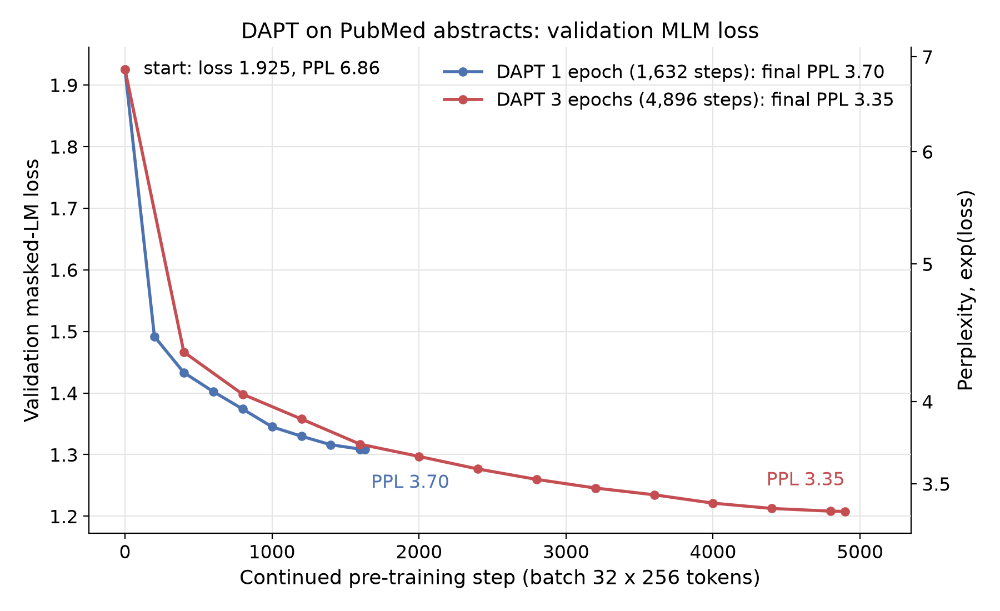
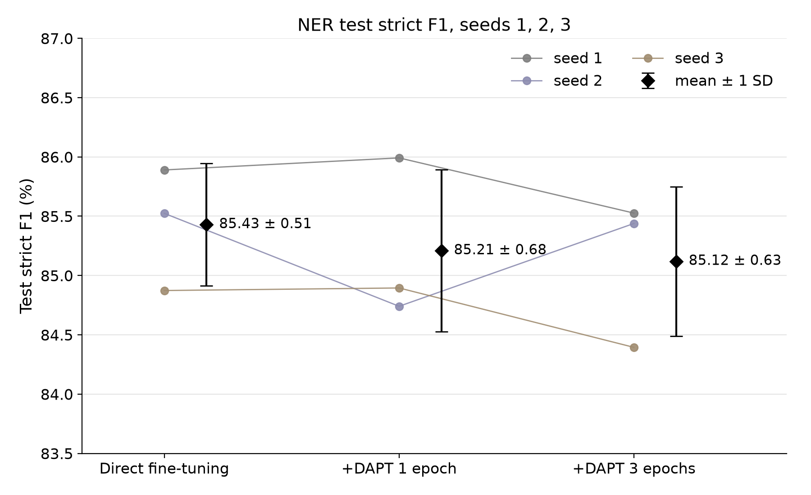
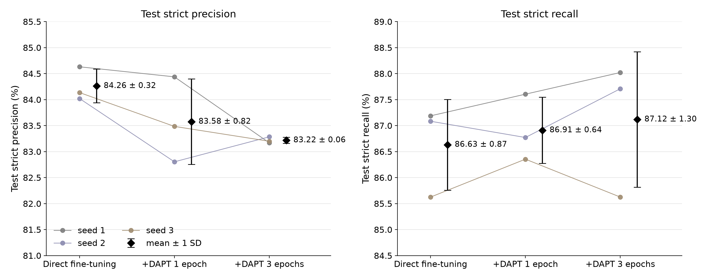

# Disease NER on NCBI Disease (BERT / BioBERT / PubMedBERT)

COMP9444 group project: token-classification models for disease mention recognition on the
[NCBI Disease](https://huggingface.co/datasets/ncbi/ncbi_disease) corpus (labels `O`, `B-Disease`, `I-Disease`).

```
audit_ncbi_splits.py        data audit (CoNLL-only, or CoNLL vs. Hugging Face)
ner/                        unified experiment framework
  data.py                   download + SHA-256 check + parse CoNLL, audit summary
  models.py                 model registry (pinned revisions, tokenizer casing check)
  train.py                  one model x one seed  -> runs/<model>/seed<k>/
  sweep.py                  many models x seeds, then aggregate
  aggregate.py              mean ± std markdown tables from runs/**/metrics.json
  dapt_corpus.py            unlabelled PubMed corpus for DAPT + NCBI Disease overlap removal
  dapt.py                   continued masked-LM pre-training -> runs_dapt/<name>/
  compare.py                paired per-seed comparison of two run labels
  error_analysis.py         entity-level TP / FP / FN breakdown and stable differences of two labels
  plot_dapt.py              DAPT figures -> dapt/figs/ (needs matplotlib)
dapt/pmids.txt              PMID list of the DAPT corpus (year-balanced, shuffled)
dapt/figs/                  DAPT figures used in the results below
colab_dapt.ipynb            Colab: corpus, DAPT, both fine-tuning arms, compare
baseline.ipynb              original BERT notebook (kept as is)
biobert.ipynb               original BioBERT v1.1 notebook (kept as is)
pubmedbert_baseline.ipynb   original PubMedBERT/BioBERT v1.2 notebook (kept as is)
```

## Data and audit

The single data source is the CoNLL release used by the Hugging Face loader,
[spyysalo/ncbi-disease `conll/`](https://github.com/spyysalo/ncbi-disease/tree/master/conll).
`ner` downloads it once to `data/ncbi_disease/` and refuses to run if a file's SHA-256 differs:

| split | file | sentences | tokens | B-Disease | I-Disease | orphan I | SHA-256 (prefix) |
|---|---|---:|---:|---:|---:|---:|---|
| train | train.tsv | 5432 | 136086 | 5145 | 6122 | 0 | `5f87b0de649e` |
| dev | devel.tsv | 923 | 23969 | 787 | 1090 | 0 | `b4e1e7efcc2a` |
| test | test.tsv | 940 | 24497 | 960 | 1087 | 0 | `8f088ce45dc4` |

Duplicate sentences (identical token sequences): 32 within train, 3 within test;
across splits train∩dev = 5, train∩test = 1, dev∩test = 1 (left as is, matching the official splits).

The Hugging Face `ncbi/ncbi_disease` loader yields one extra **empty** record at the end of each split
(5433/924/941). The unified framework drops empty records; the audit script ignores them when comparing.

```bash
python audit_ncbi_splits.py --no-hf --conll_dir data/ncbi_disease   # CoNLL only, no `datasets` needed
python audit_ncbi_splits.py                                          # also compare with HF (needs `datasets`)
```

The same CoNLL audit summary is printed at the start of every training run.

## Unified framework

### Setup

```bash
python -m venv .venv && source .venv/bin/activate
pip install --use-pep517 -r requirements.txt     # seqeval 1.2.2 needs --use-pep517 with recent setuptools
```

`requirements.txt` pins the versions the framework was smoke-tested with (macOS arm64, Python 3.12,
Apple MPS, torch 2.13.0, transformers 5.22.0). The code only uses APIs that also exist in
transformers 4.57.x (`eval_strategy`, `processing_class`, integer `warmup_steps`), so it is expected to
run on Colab's preinstalled stack too, but only the pinned versions were actually tested.
(The tested environment was a `--system-site-packages` venv on top of an existing conda env that already
had torch/numpy/scikit-learn; only transformers, accelerate and seqeval were pip-installed. A completely
fresh `pip install -r requirements.txt` has not been exercised.)

### Models

| key | checkpoint | revision | tokenizer |
|---|---|---|---|
| `bert` | `google-bert/bert-base-cased` (= `bert-base-cased`) | `cd5ef92a` | cased |
| `biobert` | `dmis-lab/biobert-base-cased-v1.2` | `67c9c25b` | cased (forced: the repo has no tokenizer config, so the default would lowercase) |
| `pubmedbert` | `microsoft/BiomedNLP-BiomedBERT-base-uncased-abstract` | `d673b883` | uncased |

Tokenizer casing is checked at load time and the run aborts if it is not as listed.

### Single run

```bash
python -m ner.train --model biobert --seed 1
# all options: --lr 2e-5 --epochs 3 --batch_size 8 --eval_batch_size --warmup_ratio 0 --weight_decay 0.01
#              --max_length 512 --early_stopping_patience 0 --save_total_limit 2 --keep_checkpoints
#              --save_model --train_limit N --eval_limit N --output_dir runs/<model>/seed<k>
#              --precision {fp32,bf16,fp16} (default fp32) --select_metric {strict_f1,default_f1} (default strict_f1)
#              --no_test_history
python -m ner.train --model bert --seed 1 --train_limit 200 --eval_limit 200 --epochs 1   # smoke test
```

What a run does:

- labels go on the **first sub-token** of each word (other sub-tokens / special tokens = `-100`);
  a self-check asserts that the kept labels reproduce the original word labels for every sentence;
- defaults match the old notebooks: lr 2e-5, batch 8, 3 epochs, no warmup, weight decay 0.01, linear decay, AdamW;
- `set_seed(seed)` plus `seed = data_seed = seed`;
- trains in **FP32** by default. `--precision bf16` needs native bf16 (Ampere or newer CUDA GPUs, or Apple
  MPS) and aborts otherwise, e.g. on a Tesla T4; `--precision fp16` uses AMP with a grad scaler. Both
  were only smoke-tested on Apple MPS, not on CUDA. Mixed precision is never switched on automatically;
- evaluates on dev after every epoch and **selects the epoch with the best dev entity F1**, by default the
  **strict IOB2** F1 that is also the headline metric (`--select_metric strict_f1`, i.e.
  `metric_for_best_model="strict_f1"`); `--select_metric default_f1` selects on seqeval default-mode F1
  (the v1 behaviour); optional early stopping;
- after every dev evaluation it also scores the **test** set with the current weights and stores it as
  `test_history` (default/strict P/R/F1 and token accuracy per epoch). This is record-only: it never takes part
  in selection, and RNG states are saved/restored around it so training is unchanged (`--no_test_history`
  turns it off). It allows reporting a "fixed last epoch" protocol next to the dev-selected one;
- evaluates the selected model on dev and test with seqeval entity-level P/R/F1 in **default** mode and
  **strict** mode (`mode="strict", scheme=IOB2`), plus word-level token accuracy;
- writes `runs/<model>/seed<k>/metrics.json` (full config, actual `precision`, the full `training_args`,
  model revision, data SHA-256, device, library versions, dev history, `test_history`, training-loss history,
  best epoch, dev/test metrics, timings) and `dev_predictions.jsonl` /
  `test_predictions.jsonl` (`{"id", "tokens", "gold", "pred"}` per sentence, word level) for error analysis;
- deletes checkpoints afterwards unless `--keep_checkpoints`; `--save_model` keeps the selected model.

Note: with transformers 5.x, `Trainer`'s own best-model reload skips BERT LayerNorm weights (they are
saved under legacy `gamma`/`beta` names; you will see an "unexpected keys" warning). `ner.train`
therefore loads the best checkpoint through `from_pretrained` and copies its weights (`load_state_dict`,
strict, identical key sets) into the trainer's own model object, so the final evaluation uses the same
accelerate wrapping / autocast precision as the per-epoch dev evaluations. The run **aborts** if the
reloaded model does not reproduce the best epoch's dev default and strict F1 within 1e-6
(`selection.best_checkpoint_reload_f1_gap` in `metrics.json`, expected 0).

### Multiple seeds and aggregation

```bash
python -m ner.sweep --models bert biobert pubmedbert --seeds 1 2 3                # runs sequentially, then aggregates
python -m ner.sweep --models biobert --seeds 1 2 3 -- --warmup_ratio 0.1 --epochs 5 \
       --early_stopping_patience 2                                                # args after -- go to ner.train
python -m ner.aggregate runs/ --out results.md                                    # mean ± sample std tables
```

`ner.sweep` skips runs whose `metrics.json` already exists (`--overwrite` to redo). Use a different
`--runs_dir` per hyper-parameter setting. `ner.aggregate` groups runs by protocol (precision + selection
metric; it prints a warning if one directory mixes protocols) and then by model (runs with
`--train_limit/--eval_limit` are shown separately as "limited/smoke"). For each protocol it reports dev and
test at the **dev-selected** epoch and test at the **fixed last epoch** (from `test_history`; older runs
without it are skipped and listed), each with strict and default scores.

### Colab

```python
!git clone <repo-url> group_project
%cd group_project
!pip install -q --use-pep517 "transformers==5.22.0" "accelerate==1.15.0" "seqeval==1.2.2"   # keep Colab's torch
!python -m ner.sweep --models bert biobert pubmedbert --seeds 1 2 3
# copy runs/ to Drive before the session ends, e.g.:
# from google.colab import drive; drive.mount('/content/drive'); !cp -r runs /content/drive/MyDrive/ncbi_runs
```

Training is FP32 unless `--precision` says otherwise (a Colab T4 has no native bf16, so `--precision bf16`
aborts there). If Colab's torch is too old for
transformers 5.22, either upgrade torch or try transformers 4.57.x (untested, see above).

## Domain adaptation (continued MLM pre-training)

Fixed starting model `bert` (bert-base-cased), two arms with identical NER data, `ner.train` settings,
seeds (1/2/3), FP32 training and strict-F1 dev selection:

* **direct**: `ner.train --model bert` (label `bert`);
* **DAPT**: continue masked-LM pre-training of the same checkpoint on unlabelled PubMed abstracts
  (`ner.dapt`), then `ner.train --model bert --init_from <dapt>/model` (label `bert+dapt`).

```bash
python -m ner.dapt_corpus search                    # one-off; result committed as dapt/pmids.txt
python -m ner.dapt_corpus build --limit 30000       # -> data/dapt/corpus_{train,valid}.txt, audit.json
python -m ner.dapt_corpus positive_control          # the text-overlap pass must fire on known overlap
python -m ner.dapt --model bert --max_steps 10000   # -> runs_dapt/bert_dapt/{model/,dapt.json}
#   runs reported below: --epochs 1 --eval_steps 200 --output_dir runs_dapt/bert_dapt_1ep
#                        --epochs 3 --eval_steps 400 --output_dir runs_dapt/bert_dapt_3ep
#   options: --epochs (if no --max_steps) --batch_size 32 --grad_accum 1 --lr 5e-5 --warmup_ratio 0.06
#            --weight_decay 0.01 --max_length 256 --mlm_probability 0.15 --precision fp32 --seed 42
#            --eval_steps 500 --logging_steps 50 --limit_docs N --output_dir
python -m ner.dapt --model bert --max_steps 0 --output_dir runs_dapt/bert_dapt0   # zero-step control
python -m ner.sweep --models bert --seeds 1 2 3                                          # direct arm
python -m ner.sweep --models bert --seeds 1 2 3 --init_from runs_dapt/bert_dapt/model    # -> runs/bert+dapt/
python -m ner.aggregate runs/                       # bert+dapt is listed right after bert
python -m ner.compare runs/ --a bert --b bert+dapt  # per-seed deltas, mean ± std, #seeds > 0
# runs reported below use --runs_dir runs/v2 and --label bert+dapt1ep / bert+dapt3ep, e.g.
#   python -m ner.sweep --models bert --seeds 1 2 3 --runs_dir runs/v2 \
#       --init_from runs_dapt/bert_dapt_3ep/model --label bert+dapt3ep
python -m ner.error_analysis runs/v2 --a bert --b bert+dapt3ep --split test --out runs/v2/error_analysis_dapt3ep.md
python -m ner.plot_dapt --runs_dir runs/v2 --dapt_dir runs_dapt --out_dir dapt/figs   # needs matplotlib
```

`colab_dapt.ipynb` runs the whole pipeline on Colab (corpus, a 200-step timing probe, DAPT, optional
zero-step control, both sweeps, aggregate, compare) with all outputs on Google Drive.

**Corpus.** `search` asks NCBI E-utilities (esearch, only `tool=ncbi-ner-dapt`, no e-mail or API key,
≤ 3 requests/s with retries) for
`diseases category[MeSH Terms] AND hasabstract[text] AND english[Language] AND <yyyy/mm>[pdat]`
for each month of the publication years 1990–2012 and takes the same number of PMIDs per year
(30000 / 23: the first 8 years get 1305, the others 1304), spread evenly over the months. esearch only
returns the first 10,000 hits of a query, in "most recently added" order, so taking the first k of a whole
year would mostly pick records added to PubMed long after publication; instead each month's quota is drawn
with a fixed seed from the first 9999 hits of that month (records with a year-only date fall into January;
a PMID already taken by another window is skipped). The union is shuffled with a fixed seed.
`dapt/pmids.txt` is committed (`dapt/pmids_meta.json` records query, per-year counts and date), so the first
N lines are a deterministic, year-balanced subset even though PubMed keeps changing. `build` fetches title + abstract (`Article/Abstract/AbstractText`, all
sections joined; records with only an `OtherAbstract` or none count as "without abstract") with efetch
(POST, 200 per request, cached in `data/dapt/raw.jsonl`).

**Overlap removal.** (1) every document whose PMID is in the original NCBI Disease train, dev or test
corpus (PubTator files from spyysalo/ncbi-disease `original-data/`, cached in
`data/ncbi_disease/original/`) is removed; (2) every dev/test sentence (CoNLL tokens joined) is
normalised (lower case, all non-alphanumeric characters removed) and the ones with ≥ 40 characters are
used as fingerprints; a corpus document whose normalised title + abstract contains any fingerprint is
removed entirely. About 2% of the remaining documents (hash of the PMID) form the validation corpus.
`positive_control` runs pass 2 on the original dev/test documents and on the PubMed (efetch) versions
of test documents under fake PMIDs; both must be detected.

**Checks.** `ner.dapt` reloads the saved model with `AutoModelForMaskedLM.from_pretrained` and aborts
unless every tensor equals the in-memory model and the loading report is empty (transformers 5.x saves
BERT LayerNorm weights as `gamma`/`beta`, see above). `ner.train --init_from` aborts unless only the
classifier head is newly initialised, every encoder tensor equals the DAPT checkpoint and the encoder
hash in `dapt.json`, and the encoder differs from the Hugging Face checkpoint if DAPT trained > 0 steps
(is identical for 0 steps). These verification loads run between an RNG snapshot and restore.
Validation windows are masked once with a fixed seed, so validation losses are comparable over time.

**Outputs.** `data/dapt/audit.json`: query, requested / retrieved PMIDs, documents without abstract,
counts and PMIDs removed by each pass (pass 1 per split; pass 2 with the matching dev/test sentences),
final document and word counts, SHA-256 of both corpus files. `runs_dapt/<name>/dapt.json`: starting
checkpoint and revision, corpus hashes, documents / windows, all hyper-parameters, steps, training and
validation loss history, initial and final validation loss and perplexity, encoder hash, device,
versions, timings. NER `metrics.json` gains `base_model` and `init_from` (path, corpus hashes, steps,
validation losses, check results); `model` is the label. Without `--init_from` both runs are
unchanged except for `"base_model"`, `"init_from": null` and `config.init_from/label`.

**Results (v2 protocol).** All numbers in this subsection come from the v2 protocol: FP32, the epoch with
the best dev strict F1 is evaluated on test, Apple MPS (macOS arm64), NER seeds 1/2/3, other `ner.train`
settings as in the v2 runs (lr 2e-5, batch 8, 3 epochs, no warmup). They are **not comparable** with the
v1 table further down (bert 85.17 ± 0.42 there), which used a different selection metric, mixed
precision and a T4 GPU. Sources (copies of the git-ignored run outputs, kept in the repository under `dapt/results/`): `results.md`,
`compare_dapt1ep.md`, `compare_dapt3ep.md`, `error_analysis_dapt{1,3}ep.md`, `corpus_audit.json` (the overlap
audit, `data/dapt/audit.json`), `*.dapt.json` and `metrics/*.json` (one per NER run, including the two controls).

*Corpus actually used.* 30,000 PMIDs requested and retrieved; 115 had no abstract and were dropped.
The overlap pass by PMID removed 2 documents, both from the NCBI Disease training corpus (0 from dev,
0 from test; the original corpora contain 592 / 100 / 100 unique PMIDs, the training file lists one of
them, PMID 8528200, twice, so 793 entries and 792 unique documents). The text-fingerprint pass used
1,771 dev/test sentence fingerprints and matched none (91 dev/test sentences are shorter than 40
characters and were not fingerprinted). Final corpus: 29,257 training and 626 validation documents;
the training part has about 5.9 million words (5,903,866), 9,767,545 tokens and 52,216 windows of
256 tokens (validation: 125,525 words, 1,122 windows). DAPT: batch 32, learning rate 5e-5, warmup
ratio 0.06, mask probability 0.15, seed 42; 1 epoch = 1,632 steps, 3 epochs = 4,896 steps.

*Masked-LM.* Validation perplexity goes from 6.86 (loss 1.925) to 3.70 after 1 epoch and 3.35 after
3 epochs.



*NER, mean ± sample std over seeds 1/2/3, strict IOB2, %.*

| model | dev P | dev R | dev F1 | test P | test R | test F1 |
|---|---:|---:|---:|---:|---:|---:|
| bert (direct) | 83.60 ± 0.90 | 87.00 ± 0.48 | 85.26 ± 0.56 | 84.26 ± 0.32 | 86.63 ± 0.87 | 85.43 ± 0.51 |
| bert+dapt1ep | 82.06 ± 0.76 | 86.57 ± 0.07 | 84.26 ± 0.36 | 83.58 ± 0.82 | 86.91 ± 0.64 | 85.21 ± 0.68 |
| bert+dapt3ep | 82.13 ± 0.84 | 86.79 ± 0.22 | 84.39 ± 0.38 | 83.22 ± 0.06 | 87.12 ± 1.30 | 85.12 ± 0.63 |

*Paired per-seed differences (DAPT minus direct, same NER seed), strict F1.*

| comparison | split | seed 1 | seed 2 | seed 3 | mean ± std | seeds Δ > 0 | ΔP mean | ΔR mean |
|---|---|---:|---:|---:|---:|---:|---:|---:|
| +DAPT 1 epoch | dev | -0.20 | -1.86 | -0.97 | -1.01 ± 0.83 | 0/3 | -1.54 | -0.42 |
| +DAPT 1 epoch | test | +0.10 | -0.78 | +0.02 | -0.22 ± 0.49 | 2/3 | -0.69 | +0.28 |
| +DAPT 3 epochs | dev | -0.48 | -1.50 | -0.64 | -0.87 ± 0.55 | 0/3 | -1.47 | -0.21 |
| +DAPT 3 epochs | test | -0.36 | -0.09 | -0.48 | -0.31 ± 0.20 | 0/3 | -1.04 | +0.49 |





*Zero-step control.* `ner.dapt --max_steps 0` saved a model whose encoder equals bert-base-cased
(hash check: 0 of 197 encoder tensors differ, max abs difference 0). Fine-tuned with seed 1
(`runs/v2_control/bert+dapt0/seed1`), it gives test strict F1 85.77 against 85.89 for the direct run
with the same seed, and 8 of the 940 test sentences get different predictions. The weights are the
same, so the run-to-run difference comes from non-deterministic kernels on MPS; a full MPS run is not
bit-for-bit reproducible.

*Repeat run.* The direct run with seed 1 was repeated unchanged (`runs/v2_control/bert_rerun/seed1`).
Test strict F1 per fine-tuning epoch, direct / zero-step control / repeat: epoch 1 83.00 / 83.18 / 83.14,
epoch 2 84.94 / 84.79 / 84.80, epoch 3 85.89 / 85.77 / 85.96. At a fixed epoch the three runs agree within
about 0.2 F1. The dev strict F1 of epochs 2 and 3 differs by about 0.1 in each run (84.57 vs 84.63,
84.40 vs 84.51, 84.62 vs 84.51), and in the repeat run the selection flips to epoch 2, so its reported
(dev-selected) test F1 is 84.80 instead of 85.89, with 91 of 940 test sentences predicted differently.
One configuration and one seed can therefore move the dev-selected test F1 by about 1 point on MPS.
These are three runs of one seed, not an estimate of the spread.

*Conclusion.* DAPT lowers the masked-LM loss clearly, but it does not improve NER: the mean paired test
strict F1 difference is -0.22 ± 0.49 (1 epoch) and -0.31 ± 0.20 (3 epochs) at the dev-selected epoch and
-0.33 ± 0.54 / -0.42 ± 0.36 at the fixed last epoch. All of these are within the spread over seeds and
below the repeat-run noise above, so no difference in either direction is claimed. Precision is lower in
all 12 paired comparisons at the dev-selected epoch (dev and test, both DAPT lengths, three seeds). For
3-epoch DAPT the drop is also present at matched fine-tuning epochs 2 and 3 on test (all 6 pairs, -0.74
to -1.46, mean about -1.0), which is larger than the 0.1-0.3 by which test precision differs between
the three seed-1 runs of one configuration at a fixed epoch, and the error analysis shows 40 more false
positives against 14 more true positives. For 1-epoch DAPT the matched-epoch differences are mixed
(13 of 18 pairs negative), and after fine-tuning epoch 1 DAPT is ahead on test in both arms. With one
DAPT seed and three NER seeds this is suggestive of a small precision loss, not an established effect.
Recall rises slightly on test
and is unchanged or slightly lower on dev, so the result is not a precision-for-recall trade.
`dapt/results/error_analysis_dapt*.md`
breaks the test errors down by type and lists the entities that change consistently across seeds.

*Limitations.* DAPT was run once (seed 42) per length, so DAPT-seed variance is not measured. Everything
ran on Apple MPS only; the Colab/CUDA path and fp16 were not verified with these runs. The corpus is
small (about 5.9 million words) compared with the PubMed pre-training of BioBERT or PubMedBERT.

## Results

### Previous single-seed notebook results (not comparable to the unified protocol)

These come from the original notebooks: one seed (42), HF dataset with trailing empty records,
test evaluated with the **last** epoch's weights (no dev-based selection), seqeval default mode.

| model | notebook | test P | test R | test F1 | token acc |
|---|---|---:|---:|---:|---:|
| BERT-base-cased | `baseline.ipynb` | 0.826 | 0.881 | 0.8528 | 0.984 |
| BioBERT v1.1 | `biobert.ipynb` | – | – | 0.8681 | – |

### Unified protocol v1 (dev-selected by default-mode F1, seeds 1/2/3)

Run on Colab (Tesla T4, transformers 5.22.0) with `colab_sweep.ipynb`, old-notebook hyper-parameters
(lr 2e-5, batch 8, 3 epochs, no warmup); for each seed the epoch with the best dev F1 in seqeval **default**
mode was evaluated on test. These are **v1 protocol** results produced before `--precision` existed, and
their precision was not FP32 as previously stated: v1 enabled bf16 whenever
`torch.cuda.is_bf16_supported()` returned true, which it does on a T4 through emulation, so training (and
the per-epoch dev evaluations used for selection) very likely ran in emulated bf16 autocast, while the final
dev/test evaluation used a freshly loaded, unwrapped model and therefore ran in FP32 (hence the small
non-zero `best_checkpoint_reload_f1_gap` of 0.001-0.002 in those runs). `metrics.json` of v1 did not store
the training arguments, so this cannot be confirmed from the artefacts. The current defaults (v2: FP32,
strict-F1 selection, consistent final evaluation) will replace these numbers once re-run.

**Summary (test, mean ± std over 3 seeds, %)**

| model | P (strict) | R (strict) | F1 (strict) | F1 (default) |
|---|---:|---:|---:|---:|
| bert | 83.40 ± 0.57 | 87.01 ± 0.84 | 85.17 ± 0.42 | 84.21 ± 0.42 |
| biobert (v1.2) | 86.16 ± 0.95 | 87.47 ± 2.69 | 86.79 ± 1.32 | 85.95 ± 1.35 |
| pubmedbert | 86.55 ± 0.49 | 89.10 ± 0.52 | **87.80 ± 0.25** | 87.28 ± 0.50 |

Full `ner.aggregate` output:

Scores are percentages, mean ± sample std over seeds. `default` = seqeval default mode, `strict` = mode='strict', scheme=IOB2.

#### dev

| model | n seeds | P (default) | R (default) | F1 (default) | P (strict) | R (strict) | F1 (strict) | token acc |
|---|---:|---:|---:|---:|---:|---:|---:|---:|
| bert | 3 (1,2,3) | 81.66 ± 1.29 | 87.59 ± 0.65 | 84.51 ± 0.77 | 84.08 ± 0.68 | 87.42 ± 0.58 | 85.71 ± 0.23 | 98.63 ± 0.01 |
| biobert | 3 (1,2,3) | 83.29 ± 0.91 | 88.35 ± 0.90 | 85.74 ± 0.12 | 86.03 ± 1.47 | 87.63 ± 1.41 | 86.81 ± 0.12 | 98.74 ± 0.05 |
| pubmedbert | 3 (1,2,3) | 86.05 ± 1.51 | 88.69 ± 0.22 | 87.35 ± 0.87 | 87.36 ± 1.09 | 88.61 ± 0.26 | 87.98 ± 0.66 | 98.78 ± 0.05 |

#### test

| model | n seeds | P (default) | R (default) | F1 (default) | P (strict) | R (strict) | F1 (strict) | token acc |
|---|---:|---:|---:|---:|---:|---:|---:|---:|
| bert | 3 (1,2,3) | 81.08 ± 0.79 | 87.60 ± 0.89 | 84.21 ± 0.42 | 83.40 ± 0.57 | 87.01 ± 0.84 | 85.17 ± 0.42 | 98.25 ± 0.03 |
| biobert | 3 (1,2,3) | 83.43 ± 0.88 | 88.65 ± 2.11 | 85.95 ± 1.35 | 86.16 ± 0.95 | 87.47 ± 2.69 | 86.79 ± 1.32 | 98.41 ± 0.18 |
| pubmedbert | 3 (1,2,3) | 85.19 ± 0.35 | 89.48 ± 0.79 | 87.28 ± 0.50 | 86.55 ± 0.49 | 89.10 ± 0.52 | 87.80 ± 0.25 | 98.56 ± 0.05 |

#### model selection

| model | best dev epoch per seed |
|---|---|
| bert | s1:3, s2:2, s3:2 |
| biobert | s1:2, s2:1, s3:2 |
| pubmedbert | s1:3, s2:3, s3:2 |
